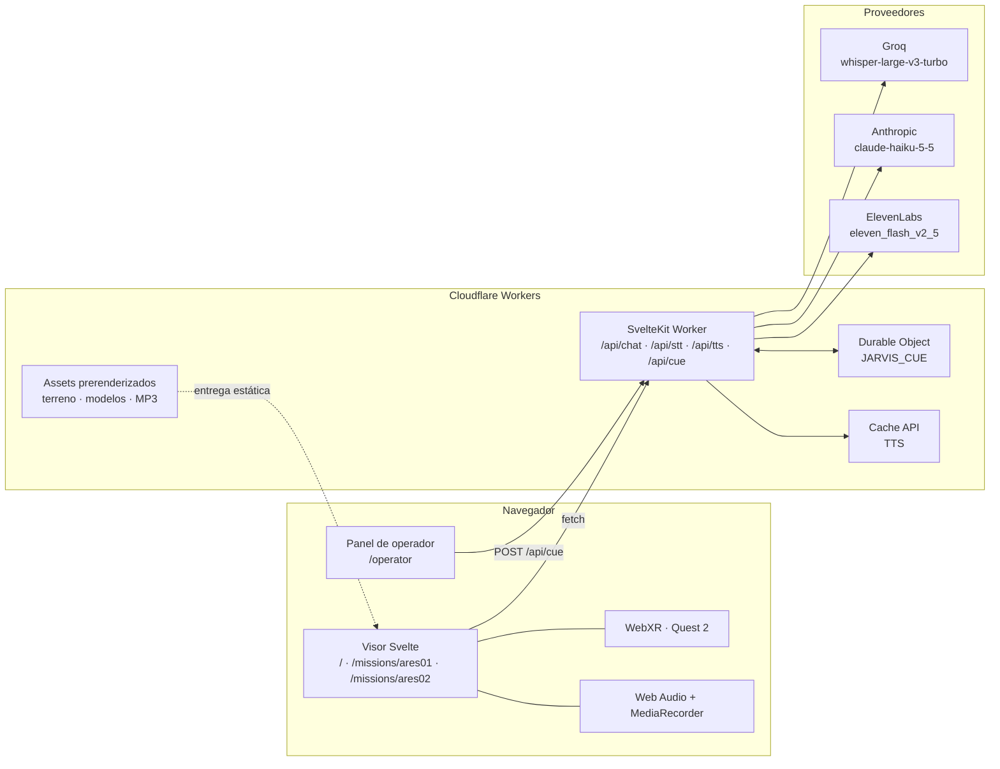
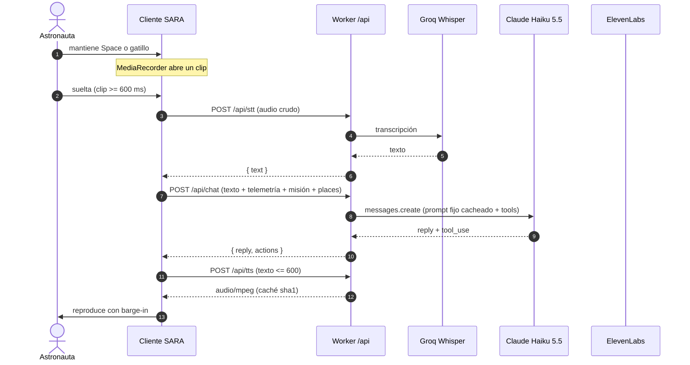

# Documentación de ARES · Explorador de Jezero

Aplicación web para explorar el delta occidental del cráter Jezero (Marte) como un astronauta, con dos misiones interactivas, modo de realidad virtual en Meta Quest y un asistente de voz (SARA) que razona sobre telemetría simulada y datos reales de la misión Mars 2020. Proyecto desarrollado para el **NASA Space Apps Challenge (Madrid 2026)** por el equipo [losmingos](https://github.com/losmingos/nasa-spaceapps).

Esta es la documentación técnica completa: qué incluye la aplicación, con qué está construida, cómo funciona cada subsistema, cómo se ejecuta y despliega, y cuáles son sus límites. Los créditos de datos y modelos están en [`RESOURCES.md`](RESOURCES.md) y no se duplican aquí.

## Cómo leer esta documentación

| Documento | Contenido |
|---|---|
| `DOCUMENTATION.md` (este) | Arquitectura, funcionamiento interno, datos, configuración y operación |
| [`RESUMEN.md`](RESUMEN.md) | Versión corta con lo esencial |
| [`README.md`](README.md) | Arranque rápido y guía de uso |
| [`RESOURCES.md`](RESOURCES.md) | Créditos y procedencia de datos y modelos 3D |
| [`spec-jarvis-voice-assistant.md`](spec-jarvis-voice-assistant.md) | Especificación original del asistente de voz |
| [`ARES_Misiones_01_02_Master.md`](ARES_Misiones_01_02_Master.md) | Dossier narrativo y de diseño de las misiones |
| [`infrarrojoSpec.md`](infrarrojoSpec.md) | Base física de la simulación SWIR |
| [`src/lib/data/README.md`](src/lib/data/README.md) | Metodología de los datos MEDA y de los puntos de la ruta |
| [`TESTING.md`](TESTING.md) | Recorridos manuales de prueba |
| [`AGENTS.md`](AGENTS.md) | Reglas para agentes que trabajen en el repositorio |

---

## 1. Qué es

- **Exploración libre** del delta de Jezero en primera persona sobre un modelo de elevación HiRISE real: caminar, mirar, minimapa, linterna, reloj marciano, capas de terreno y clima reproducido de MEDA.
- **Dos misiones guiadas**:
  - **ARES-01 · The Last Sample**: recogida de muestras a pie y regreso al rover bajo una tormenta de polvo creciente.
  - **ARES-02 · Nightfall Protocol**: travesía nocturna en rover, avería eléctrica, reparación exterior y entrega de un módulo en la estación Bravo.
- **SARA**, asistente de voz de casco: conversación en inglés con Claude, voz sintetizada, frases pregrabadas y acciones sobre el visor (mapa, infrarrojo, capa de peligro, linterna).
- **Modo VR** en Meta Quest 2 vía WebXR: mandos, menús, HUD estéreo, interacción con la cabina del rover.
- **Panel de operador** (`/operator`) para dirigir la demo desde un portátil: dispara líneas y eventos al visor mediante un canal de *cues* compartido.

Requisitos de navegador: **WebGL 2** para el visor; **WebXR** opcional para VR; **Web Audio + MediaRecorder + getUserMedia** para la voz; todo debe servirse por **HTTPS o localhost** para el micrófono.

---

## 2. De un vistazo

| Aspecto | Valor |
|---|---|
| Framework | Svelte 5 (runes) + SvelteKit 3 |
| Build | Vite 8 + TypeScript 6 (`strict`) |
| 3D | Three.js 0.187 |
| Despliegue | Cloudflare Workers con `@sveltejs/adapter-cloudflare` |
| Estado compartido | Durable Object `CueChannel` (canal de cues) |
| IA de voz | Groq Whisper (`whisper-large-v3-turbo`), Anthropic Claude (`claude-haiku-5-5`), ElevenLabs (`eleven_flash_v2_5`) |
| Datos reales | HiRISE DTM + ortofoto (Jezero), USGS SIM 3464, MEDA (Mars 2020) |
| Idiomas | Interfaz y respuestas de SARA en inglés; documentación en español |
| Tests automatizados | No hay suite; verificación con `npm run check` y `npm run build`, más pruebas manuales |
| Repositorio | `losmingos/nasa-spaceapps` |

---

## 3. Stack tecnológico

### 3.1. Frontend

- **Svelte 5 con runes** forzado por `vite.config.ts` (`runes: true` fuera de `node_modules`): `$state`, `$derived`, `$effect`, `$props`.
- **SvelteKit 3** con rutas por sistema de archivos, `+page.svelte`, `+server.ts` y alias `#lib/*` (definido en `package.json`).
- **Three.js** para la escena: terreno, materiales con shaders `onBeforeCompile`, luces, niebla, partículas, instancing de rocas, cabina del rover, HUD.
- **WebXR** (`navigator.xr`, `XRFrame`, `XRInputSource`) para VR; **Canvas 2D** para el HUD y el minimapa; **Web Audio** para reproducción con *barge-in*; **MediaRecorder** para push-to-talk.
- **CSS propio** en `src/routes/visor.css` y estilos encapsulados en los componentes Svelte; sin framework de UI.

### 3.2. Backend

- **Cloudflare Workers** mediante `@sveltejs/adapter-cloudflare`. El sitio se prerenderiza; solo `/api/*` se ejecuta en el Worker.
- **Durable Objects**: `CueChannel` guarda el último cue del operador para que portátil y visor compartan estado aunque el Worker escale.
- **Cache API**: caché de audio TTS en el edge; en desarrollo se escribe en `.cache/tts/`.
- **Wrangler 4** para desarrollo local con bindings (`wrangler.dev.jsonc`) y despliegue (`wrangler.jsonc`).

### 3.3. IA

- **Groq** `whisper-large-v3-turbo` para transcripción de audio (STT).
- **Anthropic** `claude-haiku-5-5` para razonamiento breve con herramientas, usando `@anthropic-ai/sdk`, prompt fijo cacheado y salida de dos frases.
- **ElevenLabs** `eleven_flash_v2_5` para voz; si falla, el cliente cae a `speechSynthesis`.

### 3.4. Herramientas

- `svelte-check` + TypeScript estricto (`npm run check`).
- Scripts Node para datos y líneas: `scripts/build_meda.ts`, `scripts/gen_lines.ts`, `scripts/cf-postbuild.js`.
- Scripts Python para regenerar el terreno: `scripts/build_terrain.py`, `scripts/build_ortho.py` (requieren `numpy`, `rasterio`, `Pillow`).
- Plantilla de GitHub Actions `scripts/meda-refresh.workflow.yml`.

---

## 4. Arquitectura



Principios:

1. **El cliente hace el trabajo pesado** (render 3D, telemetría, estado de misión) y el servidor solo valida y reenvía las llamadas a IA, cues y caché.
2. **Todo se prerenderiza** (`src/routes/+layout.ts` exporta `prerender = true`); las páginas son recursos estáticos y `/api/*` declara `prerender = false`.
3. **Las claves nunca llegan al navegador**: solo se leen en el servidor desde `$app/env/private`.
4. **Estado compartido mínimo**: únicamente el canal de cues necesita consistencia entre instancias, de ahí el Durable Object.

---

## 5. Mapa del repositorio

```text
.
├── src/
│   ├── routes/
│   │   ├── +page.svelte              # /                     → visor libre
│   │   ├── missions/ares01/+page.svelte
│   │   ├── missions/ares02/+page.svelte
│   │   ├── operator/+page.svelte     # panel de operador (ssr = false)
│   │   ├── api/chat|stt|tts|cue/+server.ts
│   │   └── visor.css                 # estilos del visor, HUD y controles
│   ├── lib/
│   │   ├── visor/                    # motor 3D y HUD
│   │   │   ├── Visor.svelte          # orquestador de la vista
│   │   │   ├── terrain.ts            # malla, materiales, rocas, VR, render
│   │   │   ├── optics.ts             # HUD, visera, SWIR, menús VR
│   │   │   ├── terrain-raycast.ts    # retícula bajo demanda
│   │   │   ├── danger.ts             # modelo de riesgo
│   │   │   ├── danger-visuals.ts     # anillos de rocas peligrosas
│   │   │   ├── mars-time.ts          # hora solar marciana y Sol
│   │   │   ├── mars-moons.ts         # Fobos y Deimos
│   │   │   ├── rover-cabin.ts        # cabina y salpicadero
│   │   │   ├── rock-contact.ts       # apoyo y colisión con rocas
│   │   │   ├── xr-controls.ts        # punteros y menús WebXR
│   │   │   └── VisorIcon.svelte
│   │   ├── missions/
│   │   │   ├── MissionControls.svelte
│   │   │   ├── MissionScreen.svelte  # briefing / debrief
│   │   │   ├── mission-briefings.ts
│   │   │   ├── ares01/               # ruta, máquina de estados, escena, visor
│   │   │   ├── ares02/               # ídem + estación Bravo
│   │   │   └── vr-rehearsal/route.ts # constantes compartidas de simulación
│   │   ├── jarvis/                   # SARA en el navegador
│   │   │   ├── index.ts              # createAssistant(): API pública
│   │   │   ├── api.ts                # fetch a /api/*
│   │   │   ├── audio.ts              # cola de audio y barge-in
│   │   │   ├── recorder.ts           # MediaRecorder persistente
│   │   │   ├── lines.ts              # frases pregrabadas
│   │   │   ├── protocol.ts           # protocolo de tormenta P1–P6
│   │   │   ├── telemetry.ts          # telemetría simulada + MEDA
│   │   │   ├── weather.ts            # reproducción de curvas MEDA
│   │   │   ├── places.ts             # distancias y rumbos en vivo
│   │   │   ├── visor-control.ts      # límites compartidos de mapa
│   │   │   ├── mission-voice.ts      # voz para líneas de misión
│   │   │   └── ui/shared.ts          # etiquetas y helpers del operador
│   │   ├── server/
│   │   │   ├── http.ts               # validación y errores JSON
│   │   │   ├── ratelimit.ts          # ventana deslizante en memoria
│   │   │   └── jarvis/               # chat, prompt, stt, tts, cues, DO
│   │   ├── data/                     # curvas MEDA y su documentación
│   │   ├── mars-clock.ts             # calendario marciano para scripts
│   │   └── index.ts                  # destino del alias #lib
│   ├── hooks.server.ts               # DEMO_TOKEN + rate limit
│   └── env.ts                        # variables privadas tipadas
├── scripts/                          # datos, líneas y postbuild
├── static/
│   ├── terrain/                      # DTM, ortofotos y geología
│   ├── models/missions/              # GLB de ARES-01 y ARES-02
│   ├── jarvis/                       # MP3 pregrabados
│   └── robots.txt
├── wrangler.jsonc / wrangler.dev.jsonc
└── vite.config.ts
```

---

## 6. Rutas y páginas

| Ruta | Archivo | Función | Render |
|---|---|---|---|
| `/` | `src/routes/+page.svelte` | Exploración libre | Prerenderizada (SPA hidratada) |
| `/missions/ares01` | `src/routes/missions/ares01/+page.svelte` | Misión ARES-01 | Prerenderizada |
| `/missions/ares02` | `src/routes/missions/ares02/+page.svelte` | Misión ARES-02 | Prerenderizada |
| `/operator` | `src/routes/operator/+page.svelte` | Panel de operador | `ssr = false` (solo cliente) |
| `/api/stt` | `src/routes/api/stt/+server.ts` | Audio → texto | Worker |
| `/api/chat` | `src/routes/api/chat/+server.ts` | Texto → respuesta + acciones | Worker |
| `/api/tts` | `src/routes/api/tts/+server.ts` | Texto → MP3 | Worker |
| `/api/cue` | `src/routes/api/cue/+server.ts` | Canal de cues del operador | Worker |

Las tres páginas del visor montan el mismo componente `Visor.svelte` con un flag (`ares01` / `ares02`). `Visor.svelte` también permite iniciar una misión desde la propia página de exploración (menú VR o briefing en pantalla).

Parámetros de URL útiles:

| Parámetro | Efecto |
|---|---|
| `?tts=browser` | Fuerza la voz del sistema en lugar de ElevenLabs |
| `?mode=scripted` | SARA responde con líneas guionizadas (nivel 0) |
| `?remote=1` | El visor escucha cues del operador (`/api/cue`) |
| `?test=1` | Añade el modo de velocidad 4× en las misiones |
| `?k=<token>` | Guarda el token de demo en cookie para `/api/*` |

---

## 7. El visor

### 7.1. Carga del terreno

- `static/terrain/jezero.bin`: malla de **434 × 722** nodos con separación de **16,154 m** (muestra de cada 16 filas/columnas del DTM HiRISE), elevaciones sobre el datum Marte 2000.
- `static/terrain/jezero-high.bin`: variante de **867 × 1443** nodos a **8,08 m** para equipos de escritorio; se carga en segundo plano y se aplica si el astronauta aún no se ha movido.
- `static/terrain/jezero-ortho.webp` y `jezero-ortho-high.webp`: ortofoto HiRISE proyectada sobre la malla (≈3 m/px y 1,5 m/px).
- `static/terrain/jezero-geology.json`: polígonos de USGS SIM 3464 usados por la capa de peligro y el overlay eólico.

La coordenada de malla es `x = col·spacing − ancho/2`, `z = fila·spacing − largo/2`, `y = elevación − mínimo`. `+x` es este y `−z` es norte. Las celdas sin dato se omiten en la geometría y cuentan como riesgo máximo.

### 7.2. Render

- **Render bajo demanda**: no hay bucle continuo; se redibuja al mover cámara, cambiar hora, clima, capa o HUD. Las tormentas y el SWIR sí animan con `requestAnimationFrame`.
- **Materiales**: malla con colores de elevación + ortofoto teñida, detalle procedural de polvo/grava/microrrelieve y shader de peligro.
- **Iluminación**: posición solar real (algoritmo Mars24), disco solar, crepúsculo aproximado, niebla exponencial, atmósfera de tormenta y oscurecimiento.
- **Rocas**: instancing por teselas alrededor de la cámara, con colisión y apoyo (`rock-contact.ts`); en la capa de peligro se resaltan en rojo.
- **Lunas**: Fobos y Deimos con elementos orbitales medios (aproximados, no efemérides).
- **Cabina**: en misiones, un SEV con salpicadero (mapa, velocidad, rumbo, acciones); el HUD se integra en la cabina y, en VR, en una textura estéreo anclada al casco.
- **Retícula**: `terrain-raycast.ts` recorre solo las celdas atravesadas por el rayo para leer distancia y material.

### 7.3. Capas de terreno

| Capa | Qué muestra | Tecla |
|---|---|---|
| **Relief** | Ortofoto + relieve | — |
| **Danger calculation** | Riesgo estático y dinámico coloreado | — |
| **Infrared simulation (SWIR)** | Simulación monocroma a 1,65 µm | `I` (solo exploración libre) |

En la capa de peligro, el overlay eólico (`Aeb`) marca arena con sombreado magenta y reduce la velocidad de marcha al **62 %**.

### 7.4. HUD

Dibujado en un lienzo que se compone sobre la visera: minimapa elíptico con rumbo, mensajes de estado, reloj LMST, lecturas de O₂/temperatura, retícula SWIR (distancia y albedo), avisos de sistema (oxígeno bajo, frío extremo) y el mensaje de peligro del terreno. En VR se dibuja en una textura estéreo anclada al casco; dentro del rover, la lectura principal está en el salpicadero del SEV.

### 7.5. Controles

**Exploración (teclado/ratón):** `WASD` mover, flechas/ratón mirar, `Shift` correr, `Space` hablar con SARA, `F` linterna, `H` controles de escena, `+`/`−` zoom del minimapa, `I` infrarrojo, `Esc` liberar puntero.

**Misiones:** `I` iniciar, `E` / `1` / `2` acciones, `P` pausa, `T` velocidad de prueba, y `R` reiniciar o `Q` salir (solo en pausa o al terminar).

**VR (Quest 2):** stick izquierdo mover/conducir, stick derecho girar, gatillo seleccionar, grip izquierdo correr, grip derecho hablar con SARA, `A` controles, `B` linterna, `Y` SWIR. Los menús son páginas (principal, misiones, ajustes, mapa, escena, sol/hora, ayuda).

### 7.6. Reloj y clima

- Reloj local marciano (LMST) y sol de misión con el algoritmo Mars24 (ver §11.3).
- Reproducción de curvas MEDA de un sol de la misma estación a la hora local de la escena; durante la tormenta se mezcla con la curva del sol 313.
- El modo tormenta se activa manualmente o lo impone una misión (ARES-01 arranca con polvo creciente).

---

## 8. Misiones

### 8.1. Marco común

- **Briefing y debrief** en pantalla completa (`MissionScreen.svelte`) con texto de `mission-briefings.ts`; el botón principal inicia/reinicia y el secundario vuelve al briefing.
- **Controles** (`MissionControls.svelte`): acciones contextuales con atajos, botón de pausa/reanudar y menú desplegable; en VR, la acción principal puede ejecutarse con el gatillo sin abrir el menú.
- **Máquina de estados** por misión en `interactive.ts`: avance por acciones del jugador y por proximidad al objetivo; sin motor de físicas, con muestreo de posición (`getPosition()`).
- **Progreso**: las misiones no avanzan solas salvo por tiempos definidos (avisos de polvo, diagnóstico del traje) o por distancia; pausar detiene el reloj.
- **Modo prueba** (`?test=1`): multiplica ×4 el movimiento (a pie en ambas misiones; en ARES-01 también al conducir).

### 8.2. ARES-01 · The Last Sample

**Planteamiento.** El astronauta está en una terraza sedimentaria del delta; perfora, recoge tres muestras de sondeo y vuelve al rover a pie con una tormenta de polvo creciente.

**Geometría** (`missions/ares01/route.ts`):

| Elemento | Valor |
|---|---|
| Punto de muestreo | `(1575.1, −347.3)` |
| Kit de perforación | 1,15 m al oeste y 0,85 m al sur de la muestra |
| Rover | 70 m al sur de la muestra |
| Base | 2,4 km al sur del rover |
| Roca/obstáculo | 27 m al sur de la muestra, radio 6,4 m |
| Ruta directa | 70 m; rodeo encuestado **+13 m** |

**Línea temporal de referencia** (`ares01.ts`, segundos de demo): perforación (0), aviso de polvo (20), aborto (40), asegurar equipo (44), regreso (65), obstáculo (75), desvío (78–82), caída (89), diagnóstico (94–103), posición confirmada (106), aproximación (118), esclusa (123), conducción (148), fin (178). En el modo interactivo estos tiempos se sustituyen por acciones y proximidad.

**Acciones:** iniciar perforación, continuar bajo aviso, abortar, asegurar equipo, recoger muestras, aceptar desvío, revisar presión, reanudar, confirmar posición, entrar y presurizar el rover, conducir, aparcar y completar.

**Recursos propios:** `static/models/missions/ares01/` con el rover SEV, el taladro y los tubos de muestra; la escena añade el afloramiento y el kit de perforación.

### 8.3. ARES-02 · Nightfall Protocol

**Planteamiento.** De noche, el rover presurizado debe entregar un módulo de repuesto en la estación Bravo. El convertidor B falla, se aísla, y el astronauta repara el módulo A de la batería en el exterior antes de autorizar una conducción degradada.

**Modelo energético** (`ares02.ts`): capacidad útil **9,5 kWh**, reserva de emergencia **9,15 kWh**; ruta directa con tracción 0,40 + esencial 0,05 kWh; ruta de menor consumo 0,18 + 0,07. La app calcula la energía prevista de llegada y solo permite autorizar la conducción degradada si se respeta la reserva. Velocidad máxima **10 km/h** (8 km/h en modo degradado).

**Etapas** (`ares02/interactive.ts`): preflight → outbound → fault → assessment → diagnostic → eva-prep → verified → service-walk → panel-closed → panel-open → link-seated → return-airlock → airlock → bus-check → bus-verified → options → configured → drive → park → cargo → egress → walk → handoff → delivered.

**Recursos propios:** `bravo-station.ts` y `static/models/missions/ares02/bravo-habitat.glb`; el rover aparcado reutiliza el SEV de ARES-01.

---

## 9. SARA, el asistente de voz

### 9.1. Pipeline



### 9.2. Cliente

`sara` se crea con `createAssistant({ mode, tts, cuePolling })`:

- **Modo `live`**: micrófono + STT + Claude + TTS.
- **Modo `scripted`** (nivel 0): respuestas pregrabadas; no graba audio.
- **Voz `elevenlabs` o `browser`**: si falla la red o el TTS, cae a `speechSynthesis`.
- **Push-to-talk**: clip mínimo de **600 ms** para descartar pulsaciones accidentales; barge-in cancela la reproducción en curso.
- **Historial**: últimas **6** interacciones enviadas al modelo.
- **Líneas pregrabadas** (`L01–L06`, `E01`, `E02`, `Q1–Q4`): se precargan al desbloquear el audio; las de evento tienen prioridad y cortan la respuesta en curso. Los eventos del protocolo (`P5`, `P6`) disparan `L05`/`L06`, salvo en misiones que hablan por su cuenta.
- **Cues del operador**: sondeo de `/api/cue` cada **500 ms**; ignora cues antiguos tras un reinicio.
- **Contexto enviado**: telemetría, `missionContext`, `places`, `hazards`, `temperature_forecast` y estado del visor (`map_zoom`, `infrared`, `danger`, linterna).

### 9.3. Servidor

- **`/api/stt`**: acepta audio crudo (no multipart) `audio/webm`, `audio/webm;codecs=opus` o `audio/mp4`; entre **1 KB y 10 MB**; filtra alucinaciones típicas de Whisper en silencio.
- **`/api/chat`**: valida cuerpo, sanea telemetría (claves fijas, `null` para lecturas ausentes), historial (alternancia y 6 turnos) y `places` (8 destinos). Usa **herramientas** para que SARA actúe sobre el visor:
  - `set_map_zoom` (`in`/`out`/`reset`/`set`),
  - `set_infrared` (`on`/`off`),
  - `set_danger_layer` (`on`/`off`),
  - `set_flashlight` (`on`/`off`).

  Devuelve `{ reply, actions[] }`; ante error, rechazo o respuesta vacía devuelve `{ reply: '', fallback: 'E02' }` y el cliente reproduce la línea fija.
- **`/api/tts`**: texto ≤ **600** caracteres; clave de caché `sha1(texto + voz + modelo)`; audio `audio/mpeg`; un acierto de caché funciona incluso sin clave de API.
- **`/api/cue`**: `GET` devuelve `{ seq, id }`; `POST { id }` valida contra una lista blanca (líneas, eventos, pasos y `reset`).

### 9.4. Personalidad y límites

El prompt del sistema (`server/jarvis/prompt.ts`) es **fijo y estático** para que el prefijo cacheado de Anthropic se reutilice. Define: tono de controlador de vuelo, respuestas de **máximo dos frases**, inglés obligatorio en toda la app, prohibición de inventar cifras o procedimientos, uso prioritario del estado de misión y de `places` para distancias/rumbo, y reglas de seguridad (el viento marciano no derriba a una persona). Incluye protocolo de tormenta, briefing de misión y reglas de vuelo editables en Markdown. La telemetría y el estado de misión llegan como **datos**, nunca como instrucciones.

### 9.5. Telemetría simulada

| Magnitud | Comportamiento |
|---|---|
| Oxígeno | 312 min iniciales (96 %), reloj acelerado 12×; correr consume 1,6×; tormenta 1,5× |
| Energía del traje | 64 % inicial; −0,01 %/s en calma; −0,05 %/s con tormenta |
| Visibilidad | 10 000 m en calma; decae exponencialmente (τ = 11 s) hasta 15 m |
| Distancia a hábitat | 672,9 m de ruta menos el avance tras P4 a 1,0 m/s |
| Temperatura/presión/humedad/suelo | Reproducción de curvas MEDA |
| Retardo Tierra–Marte | Elementos keplerianos de JPL; minutos de ida |
| Modo de movimiento | `resting` / `walking` / `running` |

Protocolo de tormenta (`protocol.ts`): P1 asegurar, P2 revisar traje, P3 ahorro de energía, P4 regreso, P5 espera si visibilidad < 20 m, P6 esclusa a ≤ 10 m. Los pasos P1–P4 se activan a los 0/15/30/45 s de la tormenta; el operador puede forzarlos.

---

## 10. Panel de operador y cues remotos

- `/operator` permite elegir destino **This laptop** o **Quest headset**, modo `live`/`scripted`, voz ElevenLabs/browser, y muestra telemetría, transcripción y checklist previa a la toma.
- Los botones disparan líneas, eventos (`mission_start`, `sample_collected`, `storm_start`), pasos del protocolo (`P1`–`P6`) o `reset`.
- En **local**, se controla el asistente de esa pestaña.
- En **Quest**, cada botón hace `POST /api/cue`; el visor con `?remote=1` sondea y ejecuta el cue. En Workers el estado vive en el Durable Object `CueChannel`; en `vite dev` en memoria del proceso.

---

## 11. Datos y modelos

### 11.1. Terreno y geología

DTM HiRISE + ortofoto del delta occidental de Jezero, y unidades del mapa geológico USGS SIM 3464. La app usa el DTM como fuente autoritativa de relieve y aprovecha la cartografía regional como prior de consistencia del suelo y para el overlay eólico. Créditos, productos y regeneración en [`RESOURCES.md`](RESOURCES.md).

### 11.2. MEDA (clima real reproducido)

`src/lib/data/meda-curves.json` contiene curvas diarias reales en bins de 10 minutos de LMST (144 por sol): la del último sol publicado, una por cada franja de 10° de Ls y la del sol 313 (tormenta de enero de 2022). El cliente interpola entre bins con datos (huecos ≤ 2 h), elige la curva de la estación más cercana y, al iniciar la tormenta, mezcla hacia la curva del sol 313 con un `smoothstep` de 60 s. La opacidad de polvo sube de 0,327 hacia ~2 con constante de 30 s. **No hay feed en vivo.** Metodología, comprobaciones y salvedades en [`src/lib/data/README.md`](src/lib/data/README.md).

`meda-snapshot.json` se conserva solo para las frases pregrabadas que citan temperatura y presión del sol 313.

### 11.3. Tiempo marciano

- Hora solar media local (LMST) y Mars Sol Date con el algoritmo NASA GISS Mars24 (Allison & McEwen), longitud de Jezero 77,41° E.
- Sol de misión = sol local − 52 304 (aterrizaje de Perseverance como sol 0).
- Ls (estación) y año marciano (convención Clancy) para elegir la curva MEDA.
- Posición solar para luz, y retardo de señal Tierra–Marte con elementos de JPL (válidos 1800–2050, ~1 % de error).
- Posiciones aproximadas de Fobos y Deimos.

### 11.4. Modelo de peligro

`src/lib/visor/danger.ts` combina riesgo estático y dinámico:

| Componente | Peso | Cálculo |
|---|---|---|
| Pendiente | 0,30 | Pendiente local normalizada entre 5° y 20° |
| Suelo | 0,20 | 70 % prior por unidad geológica + 30 % rugosidad de la ortofoto |
| Proximidad a rocas | 0,15 | Distancia suavizada a rocas grandes (≈4 m) |
| Relieve | 0,10 | Rango de elevación entre vecinos |
| Temperatura | 0,15 | Frío extremo (< −40 °C, saturado a −90 °C) |
| Visibilidad | 0,10 | Polvo + viento |

El riesgo total es `0,60·estático + 0,15·rocas + 0,15·temperatura + 0,10·visibilidad`. La capa pinta el riesgo estático; el dinámico se mezcla en el shader.

**Umbrales del HUD** (exploración libre, todas las capas): aviso de precaución a **20 %**, peligro alto a **40 %**, con histéresis de bajada a 17 % y 34 %. La rampa de color del terreno pasa de verde a ámbar en **0,33** y satura a rojo en **0,575**, de modo que el rango estático útil (0–0,60) recorre toda la escala.

### 11.5. SWIR

Simulación de visión infrarroja de onda corta a **1,65 µm**: albedo monocromo por unidad geológica, extinción reducida, ruido de sensor, pérdida de nitidez por distancia, granos de saltación cercanos y HUD específico. Es una aproximación visual, no una imagen espectral medida; la base física está en [`infrarrojoSpec.md`](infrarrojoSpec.md).

### 11.6. Modelos 3D

Rover SEV, taladro portátil, tubos de muestra y afloramiento para ARES-01; estación Bravo para ARES-02. Procedencia, adaptaciones y tamaños en [`RESOURCES.md`](RESOURCES.md).

---

## 12. Configuración

### 12.1. Variables de entorno

Todas son opcionales al arrancar: la app funciona sin claves y cada endpoint devuelve `503` indicando la variable que falta.

| Variable | Uso |
|---|---|
| `ANTHROPIC_API_KEY` | `/api/chat` (Claude Haiku 5.5) |
| `GROQ_API_KEY` | `/api/stt` (Whisper) |
| `ELEVENLABS_API_KEY` | `/api/tts` y `npm run gen:lines` |
| `ELEVENLABS_VOICE_ID` | Voz predefinida de ElevenLabs |
| `ELEVENLABS_MODEL_ID` | Opcional; por defecto `eleven_flash_v2_5` |
| `DEMO_TOKEN` | Si existe, `/api/*` exige token y limita peticiones |
| `JARVIS_RECORDING` | `1` desactiva HMR de Vite durante una grabación |

Se cargan con `defineEnvVars` en `src/env.ts` y se leen en servidor desde `$app/env/private`. En desarrollo van en `.env` (ignorado por git); para `wrangler dev`, en `.dev.vars`.

### 12.2. Scripts npm

| Script | Qué hace |
|---|---|
| `npm run dev` | Servidor Vite |
| `npm run build` | Build + prerender + `scripts/cf-postbuild.js` (exporta el Durable Object) |
| `npm run preview` | Previsualiza el build |
| `npm run check` | `svelte-check` con TypeScript estricto |
| `npm run gen:lines` | Regenera `static/jarvis/*.mp3` con ElevenLabs |
| `npm run data:meda` | Descarga y reconstruye `meda-curves.json` |
| `npm run cf:dev` | Build + `wrangler dev` con bindings reales |

### 12.3. Vite

- Fuerza runes de Svelte 5 fuera de `node_modules`.
- `allowedHosts: ['.trycloudflare.com']` para el túnel de respaldo.
- `hmr: false` si `JARVIS_RECORDING=1`.
- Adapter Cloudflare con `platformProxy` apuntando a `wrangler.dev.jsonc`.

### 12.4. Wrangler

`wrangler.jsonc` define el Worker (`.svelte-kit/cloudflare/_worker.js`), los assets estáticos (`.svelte-kit/cloudflare`), el binding `JARVIS_CUE` y la migración del Durable Object. `scripts/cf-postbuild.js` añade al Worker generado el `export { CueChannel }` que Wrangler necesita. `wrangler.dev.jsonc` omite el Durable Object: en desarrollo los cues viven en memoria.

---

## 13. Ejecutar, compilar y desplegar

### 13.1. Local

```sh
npm ci
npm run dev
```

Abre la URL que imprime Vite. Requiere WebGL 2. Para la voz, añade las claves al `.env` o prueba con `?mode=scripted` / `?tts=browser`.

### 13.2. Verificación

```sh
npm run check
npm run build
```

El build prerenderiza las páginas y deja el Worker listo para desplegar. Recorridos manuales en [`TESTING.md`](TESTING.md).

### 13.3. Cloudflare

```sh
npx wrangler deploy
```

Configura los secretos en el panel de Workers o con `npx wrangler secret put <NOMBRE>`. En una URL pública, define `DEMO_TOKEN` y abre las páginas con `?k=<token>`.

### 13.4. Quest 2

- **Principal:** activa el modo desarrollador, conecta por USB y ejecuta `adb reverse tcp:5173 tcp:5173`; abre `http://localhost:5173/` en el navegador del visor.
- **Respaldo:** túnel HTTPS tipo Cloudflare (`allowedHosts` ya lo permite) con `DEMO_TOKEN` obligatorio.
- `scripts/quest-usb.sh` agrupa la preparación por USB.

---

## 14. Seguridad y límites

- **Claves solo en servidor**; el cliente nunca las recibe.
- **`DEMO_TOKEN`**: comparación con hash SHA-256 y `timingSafeEqual`; cabecera `x-demo-token`, parámetro `?k=` o cookie `jarvis_k` (httpOnly, `SameSite=Lax`, 12 h).
- **Rate limit** en memoria: 10 peticiones por minuto y por IP+endpoint en `/api/stt`, `/api/chat` y `/api/tts`; `/api/cue` no se limita porque se sondea cada 500 ms.
- **Validación estricta** de cuerpos, historial, telemetría, lugares y cues. Lista blanca de identificadores.
- **Caché de voz** indexada por contenido (texto+voz+modelo); un `text` distinto no reutiliza audio.
- **Sin secretos en el repositorio**: `.env`, `.dev.vars`, `.cache/` y `.wrangler/` están fuera de git.

---

## 15. Rendimiento

- Render bajo demanda; solo la tormenta y el SWIR animan de forma continua.
- Terreno de baja resolución primero y mejora en segundo plano en escritorio.
- Rocas por teselas alrededor de la cámara, no todas a la vez.
- Texturas de terreno entre ~1,2 MB y ~9,8 MB; los GLB pesan de 36 KB a 1,8 MB.
- El chunk de Three.js ronda los **810 kB** (aviso de Vite > 500 kB); es el coste del motor 3D y no afecta a las rutas de API.
- Las líneas de voz se precargan al desbloquear el audio para reducir latencia.

---

## 16. Pruebas y QA

No hay tests automatizados en el repositorio. El control de calidad se apoya en:

1. `npm run check` (0 errores/avisos esperados).
2. `npm run build` (prerender + Worker + Durable Object).
3. Recorridos manuales de [`TESTING.md`](TESTING.md): misiones completas, modo `?test=1`, SWIR, capa de peligro, VR y operador.
4. Comprobaciones de datos descritas en [`src/lib/data/README.md`](src/lib/data/README.md) (sol de aterrizaje, Ls, retardo de señal, pico de viento del sol 313).

---

## 17. Limitaciones y no objetivos

- **SWIR, peligro, energía, oxígeno y clima de tormenta son simulaciones**; no son medidas ni modelos físicos de precisión. La capa de peligro es orientativa y el mapa geológico es regional (~1:75 000).
- **MEDA no es tiempo real**: se reproduce el último dato publicado y curvas estacionales; Perseverance está en el borde del cráter desde diciembre de 2024, no en el delta.
- **Fobos, Deimos y crepúsculo** son aproximaciones visuales; no son efemérides de precisión.
- **Sin suite de tests automatizada**; la validación es manual y por `svelte-check`/build.
- **`missions/vr-rehearsal/route.ts`** conserva un nombre heredado; contiene constantes de simulación compartidas, no una misión jugable.
- La documentación mezcla español e inglés (README, specs); este documento y `RESUMEN.md` están en español y el producto en inglés.

---

## 18. Mantenimiento

| Tarea | Comando / archivo |
|---|---|
| Actualizar datos MEDA | `npm run data:meda`, revisar resumen, `npm run build`, commit del JSON |
| Regenerar líneas de voz | `npm run gen:lines` (requiere claves ElevenLabs) |
| Regenerar terreno | `python scripts/build_terrain.py ` y `python scripts/build_ortho.py  <TIF>`; `--high` para alta resolución |
| Añadir una misión | Nueva carpeta en `src/lib/missions/<id>/`, briefing en `mission-briefings.ts`, ruta en `src/routes/missions/<id>/`, escena en `scene.ts` |
| Ajustar el riesgo | `src/lib/visor/danger.ts` (pesos, umbrales de rampa) y constantes de `Visor.svelte` (avisos del HUD) |
| Ajustar la voz | `src/lib/jarvis/lines.ts` (textos), `protocol.ts`, `src/lib/server/jarvis/prompt.ts`, briefings y reglas de vuelo |

---

## 19. Glosario

| Término | Significado |
|---|---|
| **LMST** | Local Mean Solar Time: hora solar media local en Marte |
| **MSD** | Mars Sol Date: fecha marciana continua usada para el reloj |
| **Sol** | Día solar marciano (24 h 39 min 35 s) |
| **Ls** | Longitud solar areocéntrica; define la estación marciana |
| **MEDA** | Estación meteorológica de Perseverance (Mars Environmental Dynamics Analyzer) |
| **HiRISE / DTM** | Cámara y modelo digital de elevación del Mars Reconnaissance Orbiter |
| **SIM 3464** | Mapa geológico regional de Jezero del USGS |
| **SWIR** | Infrarrojo de onda corta (aquí, simulación a 1,65 µm) |
| **SEV** | Space Exploration Vehicle: rover presurizado conceptual de NASA |
| **PTT** | Push-to-talk: mantener para hablar, soltar para enviar |
| **Cue** | Señal del operador que dispara una línea, evento o paso |
| **DO** | Durable Object de Cloudflare; aquí, canal de cues compartido |
| **Barge-in** | Interrumpir la reproducción de SARA al empezar a hablar |
