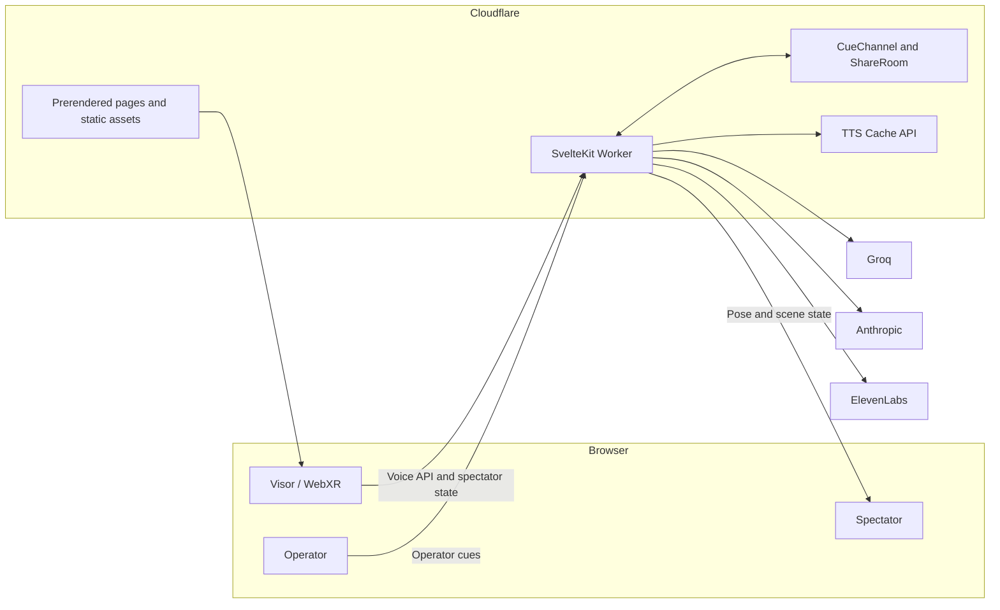
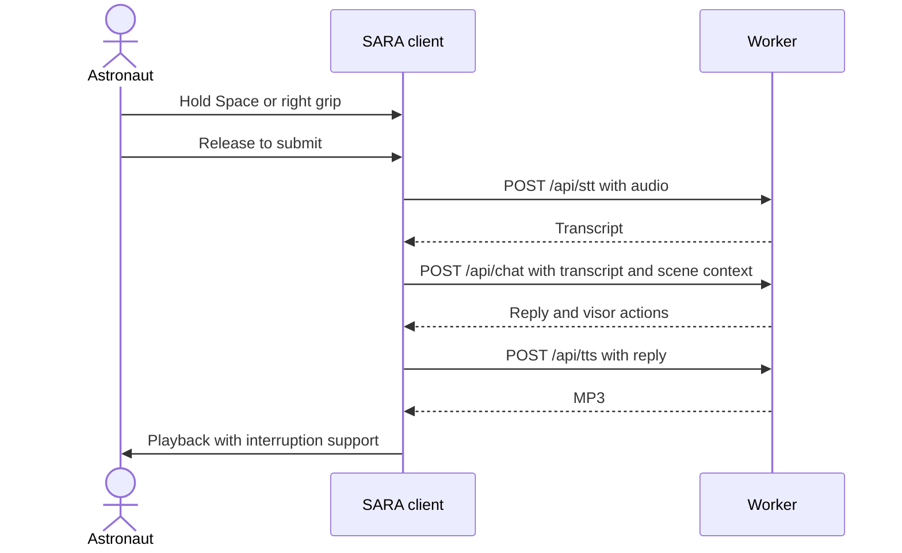

# ARES technical documentation

ARES is a first-person web explorer of Jezero Crater's western delta. It combines two interactive astronaut missions, Meta Quest 2 support through WebXR, and a voice assistant called SARA. SARA uses simulated suit telemetry and archived Mars 2020 observations. The Los Mingos team built the project for NASA Space Apps Challenge Madrid 2026.

| Document | Contents |
| --- | --- |
| [README](README.md) | Quick start, controls and deployment |
| [Project overview](RESUMEN.md) | Features and architecture at a glance |
| [Data and asset credits](RESOURCES.md) | Source products, model credits and regeneration |
| [Original voice-assistant specification](spec-jarvis-voice-assistant.md) | Design decisions and rehearsal requirements |
| [Mission design dossier](ARES_Misiones_01_02_Master.md) | Scenarios and production notes |
| [SWIR specification](infrarrojoSpec.md) | Optical and visual design |
| [MEDA methodology](src/lib/data/README.md) | Weather data and route reference points |
| [Manual testing](TESTING.md) | Mission walkthroughs |

## 1. What ARES includes

- **Free exploration.** Walk the Jezero delta on a real HiRISE elevation model with a minimap, flashlight, Mars clock, terrain layers and MEDA weather replay.
- **ARES-01 · The Last Sample.** Drill and recover survey samples before returning to a pressurized rover in a growing dust storm.
- **ARES-02 · Nightfall Protocol.** Drive at night, recover from an electrical fault and deliver a replacement module to Bravo Station.
- **SARA.** English push-to-talk conversation, synthetic and prerecorded speech, and voice controls for the map, infrared, danger layer and flashlight.
- **VR.** Two hand controllers, WebXR menus, a stereo HUD and a rover cockpit.
- **Operator and spectator views.** Trigger rehearsal cues from a laptop or show the headset's view on a PC.

The visor requires WebGL 2. VR requires WebXR. Voice uses Web Audio, MediaRecorder and getUserMedia. The microphone requires HTTPS or localhost.

## 2. Technology and architecture

| Layer | Implementation |
| --- | --- |
| UI | Svelte 5 runes, SvelteKit 3 file-based routes, TypeScript 6 in strict mode, custom CSS |
| Rendering | Three.js 0.187, WebGL 2, WebXR, Canvas 2D HUD, procedural materials via `onBeforeCompile` |
| Build | Vite 8, `svelte-check`, `@sveltejs/adapter-cloudflare`, Wrangler 4 |
| Voice | Groq `whisper-large-v3-turbo`, Anthropic `claude-haiku-5-5`, ElevenLabs `eleven_flash_v2_5` |
| Shared state | Durable Objects `CueChannel` and `ShareRoom` |
| Data | HiRISE DTM and orthomosaic, USGS SIM 3464 and Perseverance MEDA |
| Validation | Type and build checks, data checks and manual walkthroughs |

The browser owns rendering, telemetry and mission progression. SvelteKit prerenders the pages and runs the APIs in the Worker. The Worker holds service keys, validates input, forwards voice requests and relays shared state. The only persistent shared state is the operator cue channel and the spectator room. Voice audio uses the edge Cache API and falls back to disk under `.cache/tts/` in Vite development.

## 3. Repository map

| Path | Responsibility |
| --- | --- |
| `src/routes/` | Visor routes, operator, spectator, API handlers and `visor.css` |
| `src/lib/visor/Visor.svelte` | Scene orchestration and controls |
| `src/lib/visor/terrain.ts`, `terrain-raycast.ts` | Terrain meshes, materials, particle and rock instances, rendering and reticle queries |
| `src/lib/visor/optics.ts`, `xr-controls.ts`, `rover-cabin.ts` | HUD, SWIR, WebXR menus and cockpit |
| `src/lib/visor/danger.ts`, `danger-visuals.ts`, `rock-contact.ts` | Terrain hazard score, hazard overlays and contact |
| `src/lib/visor/mars-time.ts`, `mars-moons.ts` | Solar position, local time and moons |
| `src/lib/visor/share-client.ts`, `share-protocol.ts` | Spectator WebSocket sessions, room codes, scene state and binary pose packets |
| `src/lib/missions/` | Shared briefing, debrief and controls, plus ARES-01 and ARES-02 routes, state machines and scenes |
| `src/lib/missions/vr-rehearsal/route.ts` | Shared simulation constants under a legacy name |
| `src/lib/jarvis/` | Assistant API, recorder, audio queue, lines, storm protocol, telemetry and visor commands |
| `src/lib/server/jarvis/` | Chat, prompt, STT, TTS, cues and voice-provider integrations |
| `src/lib/server/vr-share.ts`, `vr-share-room.ts` | Room dispatch and relay |
| `src/hooks.server.ts`, `src/env.ts` | Demo access and private environment variables |
| `src/lib/data/`, `static/terrain/` | MEDA assets, terrain, orthomosaics and geology |
| `static/models/missions/`, `static/jarvis/` | GLB models and prerecorded MP3 files |
| `scripts/` | Python terrain generation, Node MEDA and voice scripts, and Cloudflare postbuild |
| `vite.config.ts`, `wrangler*.jsonc` | Build, dev server and Worker configuration |

## 4. Routes and URL options

| Route | Purpose |
| --- | --- |
| `/` | Free exploration |
| `/missions/ares01`, `/missions/ares02` | Mission-specific entry points |
| `/vr-test` | Recommended Quest Browser entry |
| `/spectator` | PC view of a headset session |
| `/operator` | Client-only cue panel |
| `/api/stt`, `/api/chat`, `/api/tts` | Speech recognition, reasoning and speech synthesis |
| `/api/cue` | Shared operator cues |
| `/api/vr-share`, `/api/vr-share/[code]` | Room creation, joining and WebSocket relay |

The visor pages use the same `Visor.svelte` component. Free exploration can also launch a mission from the on-screen briefing or VR menu. `?tts=browser` uses system speech, `?mode=scripted` selects fixed lines, `?remote=1` listens for cues, `?test=1` enables fast movement, `?k=<token>` sets demo access, and `?code=<code>` prefills the spectator room field.

## 5. Visor

### Terrain and rendering

The default grid has 434 × 722 nodes spaced 16.154 m apart. The optional desktop grid has 867 × 1443 nodes at 8.08 m spacing and replaces the default if it finishes loading before movement starts. Elevations are referenced to Mars 2000. The HiRISE textures are approximately 3 and 1.5 m per pixel. Regional USGS polygons feed the danger and eolian overlays.

The grid uses `x = col * spacing - width/2`, `z = row * spacing - length/2` and `y = elevation - minimum`. Positive x is east and negative z is north. Missing cells are omitted from geometry and treated as maximum risk.

Camera movement and changes to time, weather, layers or HUD trigger rendering on demand. Storm and SWIR effects animate continuously. The terrain material combines elevation, tinted orthophotography and procedural dust and gravel. Rocks are instanced around the camera in tiles. The reticle walks only the terrain cells crossed by the ray. The cockpit uses the SEV model and shows the map, speed, course and contextual actions. The HUD is composited onto the visor, into the stereo headset view, or onto the rover dashboard.

### Controls and layers

| Context | Controls |
| --- | --- |
| Desktop | WASD to move or drive, mouse/arrows to look, Shift to run, Space for SARA, F for flashlight, H for scene controls, +/− for map zoom, Esc to release the pointer |
| Free exploration | I toggles SWIR |
| Missions | I starts the interactive mission, E/1/2 performs actions, P pauses, T changes test speed, R restarts and Q exits while paused or after completion |
| Quest 2 | Left stick moves, right stick turns, trigger selects, left grip runs, right grip talks to SARA, A opens controls, B switches the flashlight, Y switches SWIR |

Relief shows the orthomosaic and elevation. Danger adds a colour ramp and outlines hazard rocks. The magenta eolian overlay shows unit Aeb and reduces walking speed to 62%. SWIR simulates a monochrome 1.65 µm view with a distance and albedo reticle.

### Shared view

Open **Visor settings → Share view → Create code** and enter the eight-character code on `/spectator` on the same deployment. The PC renders a monoscopic view from the headset pose and mission state, including menus, HUD, captions and push-to-talk audio. It supports one spectator. The relay delivers mission changes in order and retains the latest pose under backpressure. The headset can end the room from the menu or by exiting VR. Closing the PC tab disconnects the spectator.

## 6. Missions

`MissionScreen.svelte` presents the briefings and debriefings. `MissionControls.svelte` exposes contextual actions and pause/resume. Each `interactive.ts` state machine advances on actions, proximity or explicit timers. Pausing stops the mission clock. Test mode accelerates walking by 4× in both missions and driving by 4× in ARES-01.

### ARES-01 · The Last Sample

| Point | Location |
| --- | --- |
| Sample | (1575.1, −347.3) |
| Drill | 1.15 m west and 0.85 m south of the sample |
| Rover | 70 m south of the sample |
| Base | 2.4 km south of the rover |
| Hazard rock | 27 m south of the sample, radius 6.4 m |
| Return | 70 m direct, plus 13 m on the surveyed detour |

The recording timeline runs through drilling (0 s), dust advisory (20), abort (40), equipment secure (44), return (65), obstruction (75), detour (78–82), fall (89), diagnostics (94–103), position fix (106), final approach (118), airlock (123), driving (148) and completion (178). The interactive player starts drilling, reacts to advisories, retrieves three survey samples, negotiates the detour, checks suit pressure, reaches and pressurizes the rover, drives back and parks.

### ARES-02 · Nightfall Protocol

The crew takes a replacement module to Bravo Station after dark. Converter B fails and is isolated. The player verifies the fault, secures the rover, checks the suit, exits, reseats the battery A service module, reboards and tests the bus. The direct route preserves the energy reserve. The player drives to Bravo, parks and carries the cargo to the entrance.

Usable energy is 9.5 kWh and the reserve is 9.15 kWh. The planned curve uses 0.40 kWh of traction and 0.05 kWh of essential power. The direct option uses 0.18 and 0.07 kWh. The interactive budget uses the actual distance at the fault point. Speed is limited to 10 km/h normally and 8 km/h in degraded drive. Bravo uses `bravo-station.ts` and the bundled habitat GLB. The parked rover reuses the ARES-01 SEV.

## 7. SARA and the operator

The client drops clips shorter than 600 ms and interrupts playback on a new push-to-talk press. It sends six recent interactions with telemetry, mission context, places, hazards, temperature forecast and visor state. Prerecorded lines `L01–L06`, `E01–E02` and `Q1–Q4` preload when audio unlocks. Event lines can interrupt a reply. Scripted mode uses fixed lines without recording, and live mode can use browser speech if ElevenLabs playback fails.

- **STT.** Accepts raw WebM/Opus or MP4 audio from 1 KB to 10 MB and filters common Whisper false transcripts.
- **Chat.** Sanitizes expected telemetry fields, up to six history turns and eight places. Tools set map zoom, infrared, danger and flashlight. Errors, refusals and empty responses return the fixed E02 fallback.
- **TTS.** Accepts up to 600 characters. `sha1(text + voice + model)` identifies cached MP3 audio. Cache hits can be served without a provider key.
- **Cues.** `GET /api/cue` returns `{ seq, id }`. POST validates an allowlisted line, event, protocol step or reset. Remote clients poll every 500 ms and ignore old cues after restarting.

The static prompt enables Anthropic prefix caching. It defines an English flight-controller voice, a two-sentence limit and rules for using mission state and live navigation values. The prompt incorporates the storm protocol, mission briefing and flight rules. Request telemetry is handled as data.

| Telemetry | Model |
| --- | --- |
| Oxygen | Starts at 312 minutes / 96%, clock 12× faster, running 1.6× and storm 1.5× |
| Suit power | Starts at 64%, falls by 0.01%/s in calm and 0.05%/s in storm |
| Visibility | Falls exponentially from 10,000 m toward 15 m with an 11 s time constant |
| Rehearsal habitat distance | 672.9 m minus progress at 1.0 m/s after P4 |
| Environment | Historical MEDA curves |
| Communication delay | One-way Earth–Mars estimate from JPL orbital elements |

Storm steps P1 to P4 secure gear, check the suit, save power and return at 0/15/30/45 s. P5 holds below 20 m visibility and P6 cycles the airlock within 10 m. The operator can trigger these steps and the `mission_start`, `sample_collected` and `storm_start` events. The operator selects **This laptop** or **Quest headset** and sees a live transcript, telemetry and rehearsal checklist. Vite stores cues in memory, and the Worker uses `CueChannel`.

## 8. Mars data and hazard model

MEDA curves use 144 ten-minute local-time bins per sol. The data includes the latest published sol, representative curves for 10° solar-longitude bins and the sol 313 dust storm. Values interpolate across gaps of up to two hours. At storm onset the app blends toward sol 313 over 60 s, with dust opacity rising from 0.327 toward 2 on a 30 s time constant. The separate snapshot supports prerecorded temperature and pressure lines.

Mars24 provides local mean solar time and Mars Sol Date at 77.41° E. The mission sol subtracts 52,304 from the local sol to make the Perseverance landing sol 0. A Clancy Mars-year convention and areocentric solar longitude (Ls) select the MEDA season. JPL elements estimate the one-way signal delay. Phobos, Deimos, twilight and atmospheric appearance are approximations.

| Hazard term | Weight | Source |
| --- | --- | --- |
| Slope | 0.30 | Local slope normalized over 5°–20° |
| Soil | 0.20 | 70% geological unit, 30% orthophoto roughness |
| Rock proximity | 0.15 | Smoothed proximity to large rocks, about 4 m |
| Relief | 0.10 | Elevation range of neighbouring points |
| Temperature | 0.15 | Below −40 °C, saturating at −90 °C |
| Visibility | 0.10 | Dust and wind |

The aggregate uses 0.60 static terrain, 0.15 rock proximity, 0.15 temperature and 0.10 visibility. The display colours static hazard before blending dynamic terms in the shader. The HUD warns at 20% and 40%, clearing at 17% and 34%. The colour ramp reaches amber at 0.33 and red at 0.575. Regional map scale is about 1:75,000. Suit energy and oxygen, hazards, storm progression and SWIR are simulated. MEDA is an archive of rover observations.

## 9. Configuration and deployment

Install dependencies with `npm ci`, run `npm run dev` and open the URL Vite prints. See the README for provider keys, browser voice and demo access. Put development secrets in `.env` or in `.dev.vars` for Wrangler. `src/env.ts` defines optional private variables. Dependent APIs return 503 when a required key is missing.

| Command | Purpose |
| --- | --- |
| `npm run dev` | Vite server |
| `npm run check` | Svelte and TypeScript checks |
| `npm run build` | Build, prerender and export the Durable Objects |
| `npm run preview` | Preview the build |
| `npm run cf:dev` | Build and run with local Worker bindings |
| `npm run gen:lines` | Regenerate prerecorded audio with ElevenLabs |
| `npm run data:meda` | Refresh historical weather curves |
| `npx wrangler deploy` | Deploy the build |

Vite enables Svelte runes outside dependencies, accepts `.trycloudflare.com` hosts and disables hot reload when `JARVIS_RECORDING=1`. Wrangler serves `.svelte-kit/cloudflare` and binds `JARVIS_CUE` and `VR_SHARE` to their Durable Objects. `scripts/cf-postbuild.js` appends the required exports. The development proxy retains cues in memory. Use `npm run cf:dev` to exercise sharing locally.

Set Worker secrets in the Cloudflare dashboard or with `npx wrangler secret put <NAME>`. Public demos using paid services should set `DEMO_TOKEN` and provide `?k=<token>` in the participant link. For Quest USB development, enable developer mode, accept USB debugging, run `adb reverse tcp:5173 tcp:5173` and open `http://localhost:5173/vr-test`. `scripts/quest-usb.sh` wraps USB setup. An HTTPS tunnel is the fallback.

## 10. Access, performance and maintenance

Demo access uses the `x-demo-token` header, `?k=` or the HTTP-only `jarvis_k` cookie (SameSite=Lax, 12 h). The server compares SHA-256 token hashes using a timing-safe comparison. STT, chat and TTS allow ten requests per minute per IP and endpoint. Cue polling uses its own path. Rooms require the demo token at creation when configured, and spectator access uses the room code and participant keys. Git ignores `.env`, `.dev.vars`, `.cache/` and `.wrangler/`.

The app loads the smaller grid first, tiles rock instances around the viewer, and preloads speech after audio unlocks. Terrain textures range from about 1.2 to 9.8 MB and model sizes from 36 KB to 1.8 MB. Vite may warn about the Three.js bundle exceeding 500 kB.

Before shipping, run check and build, then work through [manual testing](TESTING.md). To refresh MEDA, rebuild its JSON after reviewing the data summary. To regenerate terrain, use [the source products and scripts](RESOURCES.md). Add new missions under `src/lib/missions/<id>/` and `src/routes/missions/<id>/`, with a briefing and scene. Tune hazards in `danger.ts` and visor HUD thresholds. Edit speech in `lines.ts`, the protocol, prompt, briefings and flight rules.

## 11. Glossary

| Term | Meaning |
| --- | --- |
| LMST, MSD, sol, Ls | Local mean solar time, Mars Sol Date, a Martian solar day (24 h 39 min 35 s), and areocentric solar longitude |
| MEDA | Mars Environmental Dynamics Analyzer aboard Perseverance |
| HiRISE / DTM | Mars Reconnaissance Orbiter camera and digital terrain model |
| SIM 3464 | USGS regional geologic map of Jezero |
| SWIR | Short-wave infrared |
| SEV | NASA's Space Exploration Vehicle concept |
| PTT | Push to talk, then release to submit |
| Cue | Operator signal that triggers a line, event or protocol step |
| DO | Cloudflare Durable Object |
| Barge-in | Interrupting SARA's playback by starting to speak |
